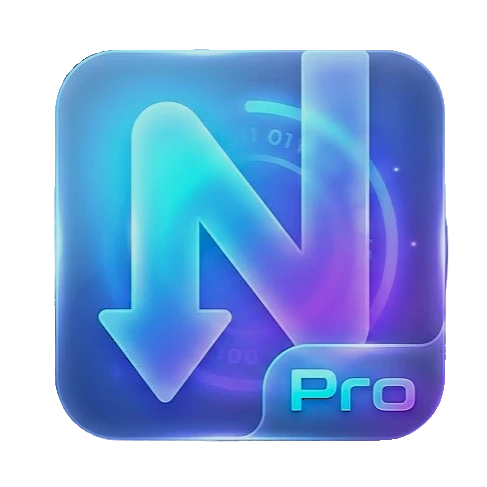

# ⚡ NPro Downloader — 2026 Ultra-Speed Download Manager

> **২০২৬ সালের আধুনিকতম গ্লাসমরফিজম UI/UX, মাল্টি-থ্রেডেড টার্বো ইঞ্জিন ও সার্বজনীন মিডিয়া ডাউনলোডার (Windows EXE & Android APK সাপোর্টেড)**



---

## 📥 সরাসরি ডাউনলোড লিঙ্ক (Download Links for Friends & Users)

আপনার বন্ধুদের এই লিঙ্কগুলো শেয়ার করে সরাসরি ডাউনলোড করতে বলতে পারেন:

| প্ল্যাটফর্ম | ডাউনলোড লিঙ্ক | বিবরণ |
| :--- | :--- | :--- |
| 📱 **Android Mobile** | [**🔗 Download NPro-Downloader.apk**](https://github.com/Naeemul-hasan/NPro-Dwonloader/releases/latest) | ২০২৬ মডার্ন UI ও অ্যান্ড্রয়েড নেটিভ DownloadManager ইন্টিগ্রেশনসহ অফিসিয়াল APK (Zero Web Redirects) |
| 💻 **Windows PC** | [**🔗 Download NPro-Downloader.zip**](https://github.com/Naeemul-hasan/NPro-Dwonloader/releases/latest) | কোনো ইনস্টলেশন ছাড়াই সরাসরি রান করার উপযোগী পোর্টেবল `.exe` |
| 🌐 **Official Releases** | [**🔗 View All Releases**](https://github.com/Naeemul-hasan/NPro-Dwonloader/releases) | অফিসিয়াল রিলিজ ও নতুন ভার্সন আপডেট পেজ |

---

## 🌟 প্রধান বৈশিষ্ট্যসমূহ (Key Features)

1. **⚡ হাইপার মাল্টি-থ্রেডেড ইঞ্জিন (IDM-লেভেল স্পিড)**:
   - যেকোনো ফাইলকে ৮ থেকে ৩২টি সমান্তরাল চঙ্কে (Chunks) ভাগ করে HTTP Range হেডারের মাধ্যমে ব্যাকগ্রাউন্ডে সমান্তরালে ডাউনলোড করে।
   - সম্পূর্ণ নেটওয়ার্ক ব্যান্ডউইথ সর্বোচ্চ মাত্রায় ব্যবহার করে (5x থেকে 10x দ্রুত গতি)।
   - পজ/রিজিউম (Pause & Resume) সাপোর্ট — নেটওয়ার্ক ড্রপ হলেও পূর্বে ডাউনলোড হওয়া অংশ সংরক্ষিত থাকে।

2. **🎥 সার্বজনীন সোশ্যাল ও মিডিয়া ডাউনলোডার (yt-dlp Engine)**:
   - YouTube, Facebook, Instagram Reels, TikTok, Twitter/X, Vimeo, SoundCloud ইত্যাদি ১০০০+ প্ল্যাটফর্ম থেকে এক ক্লিকে ডাউনলোড।
   - রেজোলিউশন সিলেক্টর: 4K UHD, 1080p Full HD, 720p HD এবং আল্ট্রা-ক্লিয়ার MP3 (320kbps) অডিও এক্সট্রাকশন।

3. **🎨 ২০২৬ আল্ট্রা-মডার্ন গ্লাসমরফিজম UI/UX**:
   - ডিপ কসমিক ডার্ক ব্যাকগ্রাউন্ডের সাথে ভাসমান অ্যাম্বিয়েন্ট অরোরা গ্লো মেশ।
   - ফ্রস্টেড গ্লাস প্যানেল (`backdrop-filter: blur(28px)`), নিয়ন সায়ান ও ভায়োলেট গ্রেডিয়েন্ট অ্যাকসেন্ট।
   - **রিয়েল-টাইম লাইভ চঙ্কস গ্রিড (Segment Visualizer)**: প্রতিটি সক্রিয় ডাউনলোডের নিচে ৩২টি থ্রেড কীভাবে সরাসরি ডেটা স্ট্রিম করছে তা জীবন্ত নিয়ন ব্লকের মাধ্যমে দৃশ্যমান।
   - **লাইভ ব্যান্ডউইথ ভেলোসিটি চার্ট**: Chart.js চালিত রিয়েলটাইম 60fps স্পিড গ্রাফ।

4. **🎵 ইন-অ্যাপ মিডিয়া প্লেয়ার**:
   - অ্যাপের ভেতরেই ডাউনলোড করা ভিডিও বা অডিও সরাসরি প্লে করে দেখার সুবিধা।

5. **📁 অটো-ক্লিপবোর্ড ও ক্যাটাগরি অর্গানাইজার**:
   - ক্লিপবোর্ডে লিঙ্ক থাকলে সরাসরি ডিটেকশন ও ওয়ান-ক্লিক পেস্ট।
   - All, Downloading, Completed, Videos, Music, Documents, Archives ক্যাটাগরি ফিল্টার।

---

## 🖥️ উইন্ডোজে সরাসরি ব্যবহারের নিয়ম (Windows .EXE)

### উপায় ১: রেডি-টু-রান স্ট্যান্ডঅ্যালোন `.EXE`
আমরা ইতিমধ্যে সম্পূর্ণ বিল্ট স্ট্যান্ডঅ্যালোন ফাইল প্রস্তুত করে দিয়েছি:
```
dist/NPro-Downloader/NPro-Downloader.exe
```
এটিতে ডাবল ক্লিক করলেই অ্যাপ্লিকেশনটি কোনো পাইথন বা কনসোল ছাড়াই সরাসরি এজ ক্রোমিয়াম চালিত নেটিভ উইন্ডোতে চালু হবে!

### উপায় ২: ব্যাচ স্ক্রিপ্ট থেকে চালু করা
প্রজেক্ট ফোল্ডারে থাকা `run_desktop.bat` ফাইলে ডাবল ক্লিক করুন।

### উপায় ৩: পুনরায় নতুন করে .EXE বিল্ড করতে চাইলে
```bash
build_exe.bat
```
অথবা:
```bash
python build_exe.py
```

---

## 📱 অ্যান্ড্রয়েডে ব্যবহারের নিয়ম (Android .APK)

### ১. ফ্রি GitHub Actions অটোমেশন (কোনো SDK ছাড়া সরাসরি APK)
1. এই রিপোজিটরিটি আপনার GitHub অ্যাকাউন্টে আপলোড করুন।
2. `.github/workflows/` ফোল্ডারে `apk_build/android_build_workflow.yml` ফাইলটি রাখুন।
3. GitHub-এর **Actions** ট্যাবে গিয়ে বিল্ড রান করলেই মাত্র ২ মিনিটে প্রস্তুতকৃত `NPro-Downloader.apk` ডাউনলোড করতে পারবেন।

### ২. Capacitor CLI দিয়ে লোকাল বিল্ড
```bash
cd apk_build
npm init -y
npm install @capacitor/core @capacitor/cli @capacitor/android
npx cap add android
npx cap sync android
npx cap open android
```
Android Studio ওপেন হলে **Build > Build Bundle(s) / APK(s) > Build APK(s)** চাপলেই `.apk` তৈরি হয়ে যাবে।

### ৩. ইনস্ট্যান্ট PWA মোড (কোনো বিল্ড ছাড়াই মোবাইলে অ্যাপের মতো)
NPro Downloader-এ ফুল `manifest.json` এবং `ServiceWorker` কনফিগার করা আছে। মোবাইলের ব্রাউজার দিয়ে লিঙ্কে প্রবেশ করে থ্রি-ডট মেনু থেকে **"Install app"** বা **"Add to Home screen"** সিলেক্ট করলেই এটি আলাদা আইকনসহ ফুলস্ক্রিন মোবাইল অ্যাপ আকারে ইনস্টল হয়ে যাবে।

---

## 📂 প্রজেক্ট ফাইল স্ট্রাকচার

```
NPro-Downloader/
│
├── core/
│   ├── downloader.py         # মাল্টি-সেগমেন্ট রেঞ্জ ইঞ্জিন ও স্পিড ক্যালকুলেটর
│   ├── media_extractor.py    # yt-dlp চালিত 4K/1080p ও MP3 ডাউনলোডার
│   └── storage.py            # হিস্টোরি ও সেটিংস পারসিস্টেন্স
│
├── server/
│   └── api.py                # FastAPI ব্যাকএন্ড ও 60fps WebSocket সার্ভার
│
├── ui/
│   ├── index.html            # ২০২৬ গ্লাসমরফিজম UI মার্কআপ
│   ├── css/style.css         # ফ্রস্টেড গ্লাস, নিয়ন গ্রেডিয়েন্ট ও অ্যাম্বিয়েন্ট ব্যাকড্রপ
│   ├── js/app.js             # রিয়েলটাইম লাইভ চঙ্কস গ্রিড, চার্ট ও স্টেট কন্ট্রোলার
│   ├── manifest.json         # মোবাইল PWA ইনস্টলেশন কনফিগ
│   ├── sw.js                 # অফলাইন সার্ভিস ওয়ার্কার
│   └── assets/               # আপনার প্রোভাইড করা NPro অফিসিয়াল আইকন
│
├── apk_build/
│   ├── capacitor.config.json # ক্যাপাসিটর অ্যান্ড্রয়েড কনফিগারেশন
│   ├── AndroidManifest.xml   # অ্যান্ড্রয়েড পারমিশন ও শেয়ার ইন্টেন্ট
│   ├── android_build_workflow.yml # গিটহাব ফ্রি APK বিল্ডার অ্যাকশন
│   └── README_APK.md         # বিস্তারিত অ্যান্ড্রয়েড গাইড
│
├── dist/NPro-Downloader/     # কম্পাইল করা স্ট্যান্ডঅ্যালোন Windows .EXE প্যাকেজ
│   └── NPro-Downloader.exe
│
├── icon.ico                  # উইন্ডোজ মাল্টি-রেজোলিউশন অ্যাপ আইকন
├── main.py                   # নেটিভ ডেস্কটপ উইন্ডো ও সার্ভার লঞ্চার
├── build_exe.py              # পাই-ইনস্টলার বিল্ড স্ক্রিপ্ট
├── build_exe.bat             # ওয়ান-ক্লিক উইন্ডোজ বিল্ডার
└── run_desktop.bat           # ওয়ান-ক্লিক উইন্ডোজ রানার
```
